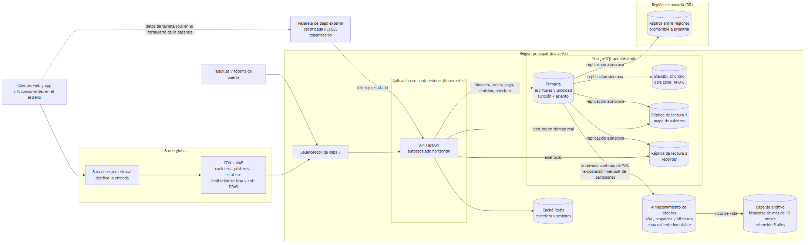

# 2. Factibilidad técnica, económica y operativa, y análisis de riesgos

## 2.1 Arquitectura propuesta

Fuente del diagrama: `docs/diagramas/arquitectura.mmd`.

| Componente | Función | Cifra que lo justifica (sección 3) |
|---|---|---|
| Sala de espera virtual | Dosifica la entrada de usuarios al flujo de compra y los atiende por orden de llegada | 8 M de usuarios concurrentes; la demanda supera 8.9 veces a la oferta del día |
| CDN con WAF | Sirve cartelera, pósteres y recursos estáticos cerca del usuario; filtra ataques y limita la tasa por cliente | 14,313 TPS resueltas en el borde; 819.2 Mbps de entrada en el pico |
| Balanceador de capa 7 | Reparte el tráfico entre los contenedores de la aplicación y retira los que fallan | 50,000 TPS al borde |
| Aplicación en contenedores (Kubernetes) | API delgada sobre las funciones de la BD, con autoescalado horizontal | 4 nodos base y 4 adicionales en el pico (sección 4.2) |
| Caché Redis | Cartelera, sesiones y estado de la sala de espera | Acierto del 95 % en las lecturas cacheables |
| PostgreSQL primaria | Todas las escrituras: bloqueo de asientos con restricción de unicidad, órdenes, pagos, emisión, check-in y bitácoras | 4,175 TPS de escritura y 9,291 filas de bitácora por segundo |
| Standby síncrono en otra zona | Conmutación automática si cae la primaria, sin pérdida de datos | RPO 0 en la región |
| 2 réplicas de lectura | Mapa de asientos en tiempo casi real y reportes, sin cargar la primaria | 31,513 TPS de lectura en el pico |
| Réplica en otra región | Recuperación ante la caída de la región completa | RPO ≤ 5 s y RTO < 5 min |
| Almacenamiento de objetos y capa de archivo | Archivado continuo de WAL, respaldos, copia inmutable de las bitácoras y archivo de las de más de 13 meses | 5 años de retención; 5.95 TB a 5 años en la BD sin niveles |
| Pasarela de pago externa certificada | Recibe los datos de tarjeta en su propio formulario y devuelve un token y el resultado | Ningún PAN ni CVV entra al sistema (RN-09) |

## 2.2 Factibilidad técnica

La solución es técnicamente factible: cada exigencia de carga y de negocio tiene un componente que la atiende, con tecnologías maduras y servicios administrados.

| Exigencia | Cómo se cumple |
|---|---|
| 50,000 TPS en el pico | El 91.7 % son lecturas: la CDN y la caché resuelven 14,313 TPS y las réplicas, 31,513. La primaria solo recibe 4,175 escrituras por segundo, cortas y sobre índices. La sala de espera evita que la ráfaga inicial supere ese ritmo. |
| Cero doble venta | Restricción de unicidad sobre (función, asiento) en la primaria, dentro de transacciones BEGIN/COMMIT/ROLLBACK. Las réplicas pueden mostrar un mapa con menos de un segundo de retraso, pero la decisión final siempre la toma la primaria. |
| Bloqueo temporal de 2 minutos | Tabla viva de bloqueos con fecha de expiración (282,486 filas en el pico) y barrido periódico de los vencidos. |
| Pagos seguros (PCI DSS) | Tokenización en la pasarela externa: la BD guarda solo el token, los últimos 4 dígitos y la marca. El alcance PCI del sistema se reduce al mínimo. |
| Bitácoras inalterables por 5 años | Cuatro tablas separadas por dominio, particionadas por mes y sin permisos de UPDATE ni DELETE. Las particiones de más de 13 meses pasan comprimidas a la capa de archivo. |
| RPO ≤ 5 s y RTO < 5 min | Replicación síncrona a otra zona (RPO 0), réplica asíncrona entre regiones (retraso de segundos), archivado continuo de WAL y conmutación automática. |
| SLA 99.99 % | Ningún componente es punto único de falla. La BD es multi-AZ, la aplicación tiene varios nodos y el borde es global. |

**Por qué PostgreSQL.** Tiene transacciones ACID completas, restricciones de unicidad (también parciales) y particionamiento declarativo por rango de fechas, y permite roles con permisos por tabla y función, funciones y triggers. Lo ofrecen administrado las dos nubes comparadas, con alta disponibilidad y réplicas de lectura. La justificación detallada del diseño físico está en la sección 6.

## 2.3 Factibilidad económica

Detalle en la sección 4. Con AWS y reserva de 1 año (opción recomendada):

| Indicador | Valor |
|---|---|
| Costo mensual (base + DR) | US$9,862.28 |
| CAPEX inicial | US$15,000 |
| Costo total a 3 años | US$406,729.80 |
| Costo por millón de solicitudes | US$16.49 |
| Costo por boleto | US$0.000657 |

El costo mensual de toda la infraestructura es menor que la venta perdida en un solo minuto de caída durante el pico, siempre que el boleto valga más de US$0.105. La inversión es económicamente factible y se justifica por la continuidad del negocio.

## 2.4 Factibilidad operativa

- **Servicios administrados.** El proveedor cloud opera la base de datos, los respaldos, la conmutación por error, el balanceador, la CDN y el WAF, y aplica los parches. El equipo propio se enfoca en el modelo de datos, la aplicación y la operación del negocio.
- **Equipo mínimo.** Un administrador de bases de datos, dos ingenieros de plataforma con guardia rotativa, desarrolladores de backend y un responsable de seguridad y cumplimiento PCI.
- **Procedimientos.** Hay guías de operación para conmutación por error, promoción de la réplica de DR, restauración a un punto en el tiempo y archivado de particiones. Se ensayan antes de cada estreno, junto con una prueba de carga.
- **Monitoreo.** Alarmas de retraso de réplicas (más de 1 s), uso de conexiones, latencia p95 del bloqueo de asientos, tasa de rechazos de la pasarela y presupuesto mensual.
- **Operación en sala.** Taquilleros y operadores de puerta usan la misma plataforma con su rol. Ante un fallo de lectura del QR o un cliente fuera de horario, se aplica el protocolo de incidencias de puerta y la operación queda en la bitácora.
- **Cumplimiento.** PCI DSS se limita a la integración con la pasarela, gracias a la tokenización. Los datos personales siguen la Ley 8968 de Costa Rica y el GDPR para clientes de la UE.

## 2.5 Matriz única de riesgo y mitigación

Escalas del enunciado: probabilidad Baja, Media o Alta; impacto Bajo, Medio o Crítico.

| ID Riesgo | Descripción del riesgo | Probabilidad | Impacto | Estrategia de mitigación / Plan de respaldo (DRP) | RTO / RPO objetivo |
|---|---|---|---|---|---|
| R-01 | Caída de la instancia primaria de la BD durante el estreno | Media | Crítico | Standby síncrono en otra zona con conmutación automática (Multi-AZ). La aplicación se reconecta por el mismo punto de conexión. | RTO < 5 min / RPO = 0 |
| R-02 | Caída de la región cloud completa | Baja | Crítico | Réplica entre regiones, promovible a primaria con una guía de operación ensayada. Cambio de DNS y del destino de la CDN. | RTO < 5 min / RPO ≤ 5 s |
| R-03 | Ataque de denegación de servicio (DDoS) en la apertura de taquilla | Alta | Crítico | CDN global con protección DDoS, reglas de WAF y limitación de tasa por cliente. Sala de espera que absorbe la ráfaga antes de la aplicación. | RTO = 0 (sin caída) / RPO = 0 |
| R-04 | Fallo o lentitud de la pasarela de pago | Media | Crítico | Tiempo de espera y reintentos idempotentes. Un pago sin respuesta se rechaza y libera los asientos (RN-10). Conmutación a una pasarela secundaria y registro de cada intento en `transaccion_log`. | RTO < 5 min / RPO = 0 |
| R-05 | Doble venta o pérdida de consistencia del inventario de asientos | Media | Crítico | Restricción de unicidad (función, asiento) en la primaria y transacciones ACID. Prueba automatizada con 20 y 50 solicitudes simultáneas por el mismo asiento antes de cada versión. | RTO = 0 / RPO = 0 |
| R-06 | Saturación de escrituras en la primaria por la ráfaga inicial | Alta | Crítico | Sala de espera que limita el ritmo de entrada, grupo de conexiones, transacciones cortas, bitácoras particionadas y aumento planificado del tamaño de la instancia antes del estreno. | RTO < 5 min / RPO = 0 |
| R-07 | Retraso de las réplicas de lectura que muestra asientos desactualizados | Media | Medio | La venta la decide la primaria (unicidad), no la réplica. Alarma si el retraso supera 1 s, retiro automático de la réplica atrasada y lectura desde la otra. | RTO < 1 min / RPO = 0 |
| R-08 | Filtración de datos de tarjeta | Baja | Crítico | Tokenización: los datos de tarjeta solo se capturan en el formulario de la pasarela certificada. Ninguna columna para PAN ni CVV, y revisión del código y del repositorio en cada versión. | No aplica (control preventivo) / No aplica: no se almacenan datos de tarjeta |
| R-09 | Corrupción o borrado accidental de datos por error humano o defecto | Media | Crítico | Roles con privilegio mínimo, bitácoras append-only y restauración a un punto en el tiempo desde el archivado continuo de WAL. | RTO < 1 h (restauración a un punto en el tiempo) / RPO ≤ 5 s |
| R-10 | Pérdida de bitácoras o incumplimiento de la retención de 5 años | Baja | Crítico | Copia mensual comprimida e inmutable de las particiones en almacenamiento de objetos, ciclo de vida a la capa de archivo y prueba trimestral de recuperación de una partición antigua. | RTO < 12 h para consultar archivo / RPO = 0 (las bitácoras recientes siguen replicadas en la BD) |
| R-11 | Caída de la caché | Media | Medio | Caché replicada. Si falla, las lecturas pasan a las réplicas de la BD. Los datos se reconstruyen solos porque son derivados. | RTO < 1 min / RPO no aplica (datos derivados) |
| R-12 | Sobrecosto cloud por picos o por operar sin reserva | Media | Medio | Reserva de 1 año en la capacidad base, autoescalado con límites, alertas de presupuesto y revisión mensual del gasto (sección 4). | No aplica / No aplica |

Notas:

- El RTO menor a 5 minutos y el RPO menor o igual a 5 segundos del enunciado se refieren a las fallas de infraestructura (R-01 a R-07).
- La restauración a un punto en el tiempo después de un error lógico (R-09) es más lenta, porque exige restaurar la base. Se ofrece con RTO < 1 h, sin cambiar el RPO.
- La política de respaldos y la justificación completa de RPO, RTO y SLA están en la sección 10.

## 2.6 Conclusión

La solución propuesta es factible en lo técnico, porque cada carga y cada regla tienen un componente que las atiende. Es factible en lo económico: US$406,729.80 a 3 años, US$0.000657 por boleto. Y es factible en lo operativo, porque los servicios administrados y los procedimientos ensayados la hacen operable por un equipo pequeño. Los riesgos críticos tienen mitigación y métricas de recuperación definidas.
