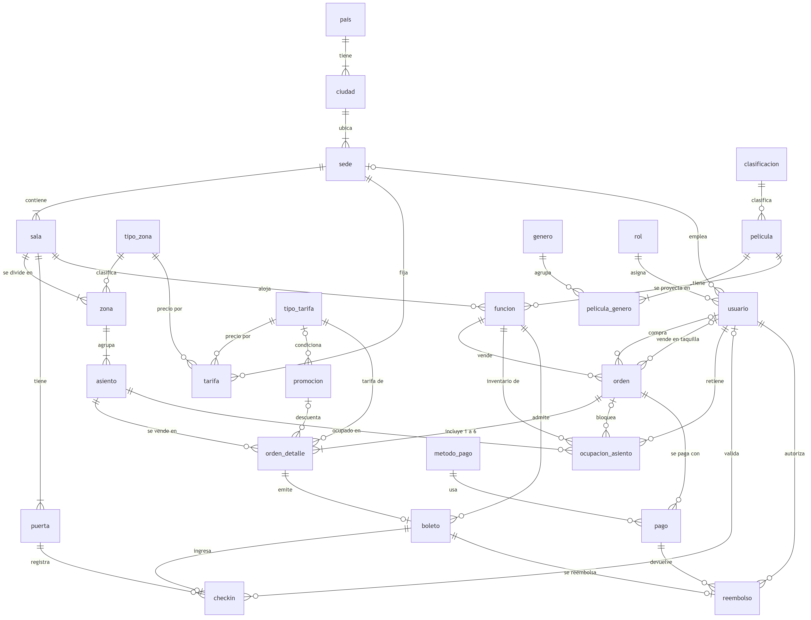
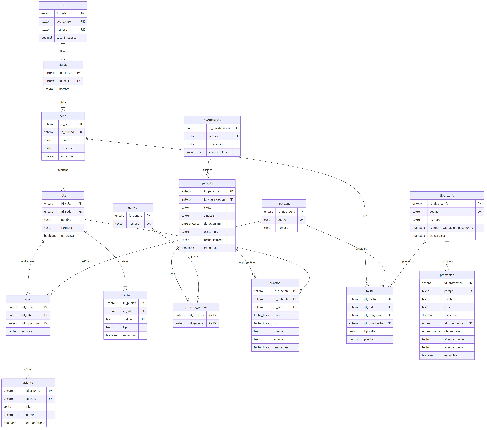
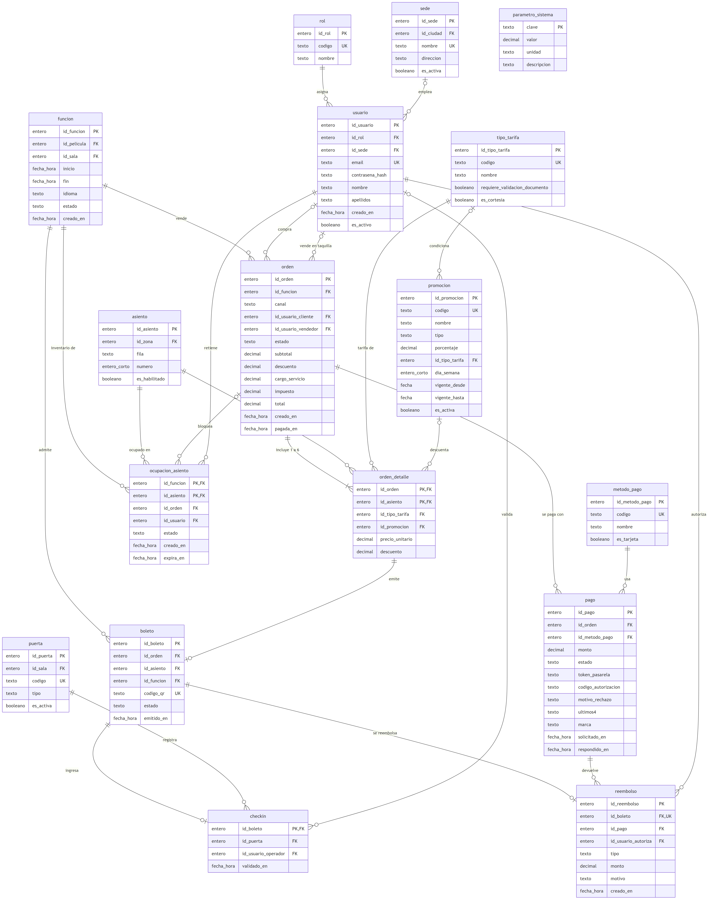
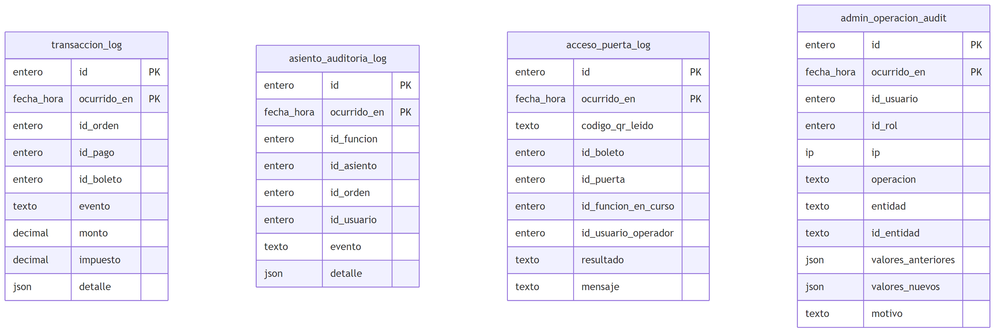

# 6. Diseño de la base de datos

Esta sección cubre el diseño conceptual (6.1), el lógico (6.2) y el físico (6.3). El diccionario completo de tablas y columnas, con todas sus claves y restricciones, está en la sección 7.

## 6.1 Diseño conceptual

### 6.1.1 Entidades

El modelo tiene 31 entidades en dos esquemas: `cine` (27, la operación) y `bitacora` (4, la auditoría a 5 años).

| Dominio | Entidades | Qué representan |
|---|---|---|
| Ubicación | pais, ciudad, sede | Dónde opera IMAX. La sede es el complejo de cines con su dirección exacta. |
| Salas y asientos | sala, tipo_zona, zona, asiento, puerta | La distribución física de cada sala: zonas (platea, palco) de un tipo de precio (general, preferencial, VIP), asientos por fila y número, y las puertas o tótems de acceso. |
| Catálogo | clasificacion, genero, pelicula, pelicula_genero | Películas u obras con sus metadatos, su clasificación de edad y sus géneros. |
| Programación | funcion | Una película en una sala y un horario. |
| Precios y promociones | tipo_tarifa, tarifa, promocion | La matriz de precios por sede, tipo de zona, tipo de entrada y tipo de día (entre semana o fin de semana), y las promociones automáticas. |
| Configuración | parametro_sistema | Los valores configurables de las reglas: máximo de asientos, minutos de bloqueo, ventana de ingreso, plazo de reembolso, cargo por servicio. |
| Seguridad | rol, usuario | Los 5 roles de la matriz de privilegio mínimo y los usuarios; el personal de sala indica su sede. |
| Venta | orden, orden_detalle, ocupacion_asiento | La compra, sus líneas (asiento y tarifa) y el inventario de asientos de cada función. |
| Pago | metodo_pago, pago | Cada intento de pago ante la pasarela y, si es con tarjeta, solo su marca y sus últimos 4 dígitos. |
| Emisión y acceso | boleto, checkin, reembolso | La entrada con su QR, su ingreso en puerta y su devolución. |
| Bitácoras | transaccion_log, asiento_auditoria_log, acceso_puerta_log, admin_operacion_audit | Las cuatro bitácoras separadas por dominio que exige la retención de 5 años. |

### 6.1.2 Relaciones y cardinalidades



Fuente: `docs/diagramas/der_conceptual.mmd`. Las cardinalidades se leen como "cada A se relaciona con (cardinalidad B) de B, y cada B con (cardinalidad A) de A".

| Entidad A | Relación | Entidad B | Cardinalidad A | Cardinalidad B |
|---|---|---|---|---|
| pais | tiene | ciudad | 1 | 1..N |
| ciudad | ubica | sede | 1 | 1..N |
| sede | contiene | sala | 1 | 1..N |
| sala | se divide en | zona | 1 | 1..N |
| tipo_zona | clasifica | zona | 1 | 0..N |
| zona | agrupa | asiento | 1 | 1..N |
| sala | tiene | puerta | 1 | 1..N |
| clasificacion | clasifica | pelicula | 1 | 0..N |
| pelicula | tiene | pelicula_genero | 1 | 1..N |
| genero | agrupa | pelicula_genero | 1 | 0..N |
| pelicula | se proyecta en | funcion | 1 | 0..N |
| sala | aloja | funcion | 1 | 0..N |
| sede | fija | tarifa | 1 | 0..N |
| tipo_zona | precio por | tarifa | 1 | 0..N |
| tipo_tarifa | precio por | tarifa | 1 | 0..N |
| tipo_tarifa | condiciona | promocion | 0..1 | 0..N |
| rol | asigna | usuario | 1 | 0..N |
| sede | emplea | usuario | 0..1 | 0..N |
| funcion | vende | orden | 1 | 0..N |
| usuario | compra | orden | 0..1 | 0..N |
| usuario | vende en taquilla | orden | 0..1 | 0..N |
| orden | incluye 1 a 6 | orden_detalle | 1 | 1..N |
| asiento | se vende en | orden_detalle | 1 | 0..N |
| tipo_tarifa | tarifa de | orden_detalle | 1 | 0..N |
| promocion | descuenta | orden_detalle | 0..1 | 0..N |
| funcion | inventario de | ocupacion_asiento | 1 | 0..N |
| funcion | admite | boleto | 1 | 0..N |
| asiento | ocupado en | ocupacion_asiento | 1 | 0..N |
| orden | bloquea | ocupacion_asiento | 0..1 | 0..N |
| usuario | retiene | ocupacion_asiento | 1 | 0..N |
| orden | se paga con | pago | 1 | 0..N |
| metodo_pago | usa | pago | 1 | 0..N |
| orden_detalle | emite | boleto | 1 | 0..1 |
| boleto | ingresa | checkin | 1 | 0..1 |
| puerta | registra | checkin | 1 | 0..N |
| usuario | valida | checkin | 0..1 | 0..N |
| boleto | se reembolsa | reembolso | 1 | 0..1 |
| pago | devuelve | reembolso | 1 | 0..N |
| usuario | autoriza | reembolso | 1 | 0..N |

Relaciones que concentran las reglas del negocio:

- **Función y asiento se encuentran en `ocupacion_asiento`.** Es la relación M:N entre funciones y asientos: cada par (función, asiento) aparece como máximo una vez. Es el inventario de la venta.
- **Orden 1 a 1..6 líneas.** El máximo de 6 asientos por compra (RN-04) es un parámetro que se valida al bloquear.
- **Línea 1 a 0..1 boleto.** Toda línea tiene precio desde que se elige la tarifa, pero el boleto solo existe si el pago se aprueba (RN-11).
- **Boleto 1 a 0..1 check-in y 1 a 0..1 reembolso.** Un boleto entra una sola vez (RN-14) y se reembolsa una sola vez (RN-19).
- **Sede 0..1 a 0..N usuarios.** Los taquilleros y operadores de puerta pertenecen a una sede. Los clientes, el contador y el administrador no tienen sede.

## 6.2 Diseño lógico

### 6.2.1 Esquemas

| Esquema | Contenido | Motivo |
|---|---|---|
| `cine` | Las 27 tablas operativas | Concentra la operación diaria. |
| `bitacora` | Las 4 bitácoras | Separa los logs masivos (unos 87 M de filas al mes, sección 3.3) de las tablas vivas, con permisos propios: los roles de aplicación solo pueden insertar. |

Diagramas lógicos con atributos, PK y FK:







Fuentes: `docs/diagramas/modelo_logico_catalogo.mmd`, `modelo_logico_venta.mmd` y `modelo_logico_bitacora.mmd`.

### 6.2.2 Claves primarias y foráneas

- **Claves sustitutas.** Las entidades con identidad propia (sede, sala, funcion, orden, pago, boleto...) usan una PK entera generada, `id_<tabla>`. Así, ninguna FK depende de un dato de negocio que pueda cambiar, como un título o un correo. Los datos de negocio únicos llevan además su UNIQUE: `email`, `codigo_qr`, `codigo_iso`, (zona, fila, número).
- **Claves naturales compuestas donde la combinación es la regla:**
  - `pelicula_genero (id_pelicula, id_genero)`.
  - `orden_detalle (id_orden, id_asiento)`: un asiento no se repite dentro de una orden.
  - `ocupacion_asiento (id_funcion, id_asiento)`: un asiento no se ocupa dos veces en la misma función. Es la **restricción anti doble venta** (RN-05, RN-12).
  - `checkin (id_boleto)`: un boleto entra una sola vez (RN-14).
  - `parametro_sistema (clave)`.
- **Pertenencia del asiento a la sala.** Que el asiento bloqueado pertenezca a la sala de la función se valida dentro de la función que bloquea los asientos, que es el único camino para crear una ocupación.
- **Bitácoras.** Su PK es `(id, ocurrido_en)`, porque la columna de partición debe formar parte de la clave primaria de una tabla particionada. No tienen FK hacia las tablas vivas: un registro de auditoría debe sobrevivir 5 años aunque la fila original se purgue o se anule, y una FK obligaría a conservar o a borrar en cascada justo lo que se quiere auditar. Guardan los identificadores como valores.

### 6.2.3 Normalización

**Primera forma normal (1FN): valores atómicos, sin grupos repetidos.**

- Los géneros de una película no van en una lista dentro de `pelicula`, sino en la tabla `pelicula_genero`, con una fila por par.
- Los géneros, las líneas de una orden y los asientos ocupados se guardan siempre como filas, nunca como listas.
- Una orden no tiene columnas `asiento1`... `asiento6`: tiene una fila por asiento en `orden_detalle`.
- Los únicos valores compuestos son los JSON de las bitácoras (6.2.4).

**Segunda forma normal (2FN): en las tablas con clave compuesta, cada atributo depende de la clave completa.**

- En `orden_detalle (id_orden, id_asiento)`:
  - `id_tipo_tarifa`, `precio_unitario`, `descuento` e `id_promocion` dependen del par: el mismo asiento en otra orden tiene otra tarifa y otro precio.
  - La función, el cliente y el canal dependen solo de `id_orden`, así que viven en `orden` y no en el detalle.
- En `ocupacion_asiento (id_funcion, id_asiento)`:
  - `estado`, `id_orden`, `id_usuario` y `expira_en` describen la ocupación de ese asiento en esa función.
  - La fila y el número del asiento dependen solo de `id_asiento` y se quedan en `asiento`.
- `pelicula_genero` y `checkin` no tienen atributos que dependan de una parte de la clave.

**Tercera forma normal (3FN): ningún atributo no clave depende de otro atributo no clave.**

- **Ubicación.** Una tabla `sede (id_sede, nombre, ciudad, pais)` tendría la dependencia transitiva `id_sede → ciudad → pais`. Se separa en `sede → ciudad → pais`. La tasa de impuesto depende del país, así que vive en `pais`, no en la sede ni en la orden.
- **Clasificación.** Su descripción y su edad mínima dependen del código de clasificación, no de la película. Por eso `pelicula` guarda solo `id_clasificacion`.
- **Tipos y métodos.** El nombre del rol, del método de pago o del tipo de tarifa (y su bandera `requiere_validacion_documento`) dependen de su propia clave, así que van en `rol`, `metodo_pago` y `tipo_tarifa`.
- **Zonas.** El tipo de zona, que define el precio, depende de la zona, no del asiento. El asiento guarda la zona, y la zona guarda el tipo.
- **Capacidad.** No se guarda en `sala`: es la cantidad de asientos habilitados de la sala, que se obtiene con una vista. Guardarla crearía una dependencia que podría desincronizarse.
- **Columnas opcionales.** Los últimos 4 dígitos y la marca solo tienen valor en los pagos con tarjeta, y la sede solo en el personal de sala. Son columnas que admiten nulo, con un CHECK que exige que `ultimos4` y `marca` vengan juntos.

**Valores históricos, que no son dependencias transitivas.** `orden_detalle.precio_unitario` y `orden.impuesto` copian el precio de la matriz y la tasa del país en el momento de la venta. No son redundancia: son hechos del pasado que no deben cambiar si mañana cambia la tarifa o la tasa. Cada cambio de precio queda en la bitácora administrativa con su valor anterior y el nuevo.

**Totales de la orden.** `orden.total` es igual a subtotal - descuento + cargo_servicio + impuesto. Se guarda porque es el monto que se cobra y se concilia con la pasarela (RN-08). Su coherencia la garantiza una restricción CHECK, así que no puede desincronizarse.

### 6.2.4 Redundancias controladas

| Redundancia | Por qué existe | Cómo se evita la inconsistencia |
|---|---|---|
| `id_funcion` en `boleto` | Se puede derivar de la orden. Se copia para poder declarar el UNIQUE parcial (función, asiento) sobre los boletos vigentes, una segunda barrera contra la doble venta (RN-12). | Se copia de la orden al emitir el boleto, en la misma transacción, y no se modifica después. |
| `fin` en `funcion` | Es la hora programada de término, incluida la limpieza. No se deriva de la duración de la película porque el tiempo de limpieza varía por sala y por función. | CHECK `fin > inicio` y un trigger que rechaza una función que se traslape con otra de la misma sala. |
| JSON en las bitácoras (`detalle`, `valores_anteriores`, `valores_nuevos`) | Es una carga de auditoría semiestructurada: la respuesta de la pasarela y los valores de la fila antes y después del cambio, cuyo contenido varía según la tabla y la operación. No se consulta por columnas, sino que se conserva como evidencia. | Las columnas consultadas (fechas, ids, evento, resultado, usuario, rol) son atómicas. |

### 6.2.5 El inventario de asientos y la prevención de la doble venta

`ocupacion_asiento` guarda, para cada función, los asientos que no están disponibles. Su PK `(id_funcion, id_asiento)` impide físicamente que dos transacciones inserten el mismo asiento para la misma función. La segunda transacción recibe una violación de clave y hace ROLLBACK.

| Estado | Significado | Expiración |
|---|---|---|
| (sin fila) | Disponible | |
| `bloqueado` | Retenido temporalmente por un usuario mientras paga (RN-05) | `expira_en` = momento del bloqueo + 2 minutos |
| `reservado` | Retenido por un administrador: cortesía, prensa o mantenimiento (el "reservado" de la RN-03) | Sin expiración |
| `vendido` | Comprado con pago aprobado | Sin expiración |

Transiciones:

1. **Bloquear.** Verifica que los asientos sean de la sala de la función e inserta las filas en estado `bloqueado` junto con la orden pendiente, después de borrar en la misma transacción los bloqueos vencidos de esos asientos. Si alguna inserción choca con la PK, la transacción completa se revierte y no se bloquea ningún asiento de esa orden.
2. **Pagar.**
   - Si se aprueba, las filas pasan de `bloqueado` a `vendido` y se emiten los boletos.
   - Si se rechaza, las filas se borran y el asiento queda disponible de inmediato (RN-10).
3. **Expirar.** Un barrido periódico borra los bloqueos con `expira_en` vencido. Además, cada nuevo bloqueo limpia los vencidos de los asientos que pide. Como un índice único no puede depender de `now()`, la limpieza es explícita.
4. **Reembolsar.** La fila se borra y el boleto pasa a `anulado` (RN-19).
5. **Purgar.** Las filas de funciones ya terminadas se borran, porque la historia queda en `boleto`, `orden_detalle` y `asiento_auditoria_log`.

Como el bloqueo y la venta viven en la misma fila, la misma restricción cubre los dos momentos: no se puede bloquear un asiento vendido ni vender uno bloqueado por otro. El UNIQUE parcial de `boleto` sobre (función, asiento) en los boletos vigentes es una segunda barrera.

### 6.2.6 Dónde vive cada regla de negocio

| RN | Ubicación en el modelo |
|---|---|
| RN-01 | `funcion.estado` (`programada`), `funcion.inicio` y `pelicula.es_activa`, filtrados por la vista de cartelera con `inicio` futuro |
| RN-02 | NOT NULL en `pelicula.titulo`, `sinopsis`, `duracion_min`, `poster_url` e `id_clasificacion`; `funcion.inicio`; ubicación por `sala → sede.direccion → ciudad → pais` |
| RN-03 | Estado por función y asiento: sin fila (disponible), `ocupacion_asiento.estado` (bloqueado, reservado, vendido), en la vista del mapa |
| RN-04 | `parametro_sistema('max_asientos_por_orden')` = 6, validado al bloquear contra las líneas de la orden |
| RN-05 | PK de `ocupacion_asiento`, `expira_en` y `parametro_sistema('minutos_bloqueo')` = 2 |
| RN-06 | `tipo_tarifa.requiere_validacion_documento`; resultado `incidencia_documento` en `acceso_puerta_log` |
| RN-07 | `promocion` (tipo, porcentaje, tipo de tarifa, día de la semana, vigencia); `orden_detalle.id_promocion` y `descuento` |
| RN-08 | `orden_detalle.precio_unitario` y `descuento`; `orden.subtotal`, `descuento`, `cargo_servicio`, `impuesto` y `total` con CHECK de coherencia; `parametro_sistema('cargo_servicio')`; `pais.tasa_impuesto` |
| RN-09 | `pago.token_pasarela`, `pago.ultimos4` y `pago.marca`. No existe ninguna columna para el número completo ni para el código de verificación |
| RN-10 | `pago.estado` = rechazado, `pago.motivo_rechazo`, `orden.estado` = rechazada, borrado de `ocupacion_asiento`; eventos en `transaccion_log` y `asiento_auditoria_log` |
| RN-11 | `boleto` solo se inserta si la orden está pagada (regla de emisión verificada en la base de datos); `pago` con UNIQUE parcial de un solo pago aprobado por orden |
| RN-12 | `boleto.codigo_qr` UNIQUE; boleto ligado a función, asiento y zona (`asiento.id_zona`); PK de `ocupacion_asiento` y UNIQUE parcial (función, asiento) en boletos vigentes |
| RN-13 | `boleto` → `orden.id_usuario_cliente`, en la vista de las entradas del cliente |
| RN-14 | PK de `checkin` = `id_boleto`; resultado `duplicado` con el mensaje "Entrada ya utilizada" en `acceso_puerta_log` |
| RN-15 | `puerta.id_sala` frente a `boleto.id_funcion` → `funcion.id_sala`, `inicio` y `fin`; resultado `otra_funcion` en `acceso_puerta_log` |
| RN-16 | `parametro_sistema('minutos_antes_ingreso')` = 30 y `('minutos_despues_ingreso')` = 15, aplicados a `funcion.inicio`; resultado `fuera_de_horario` |
| RN-17 | `rol`, `usuario.id_rol` y `usuario.id_sede`; roles de base de datos con permisos mínimos, uno por rol |
| RN-18 | `asiento`, `zona` y `sala`, protegidas por una regla que rechaza cambios si hay `ocupacion_asiento` o boletos vigentes en funciones futuras de esa sala |
| RN-19 | `reembolso` (1 a 0..1 con boleto), `parametro_sistema('horas_limite_reembolso')` = 2 frente a `funcion.inicio`; `boleto.estado` = anulado y borrado de la ocupación |
| RN-20 | `admin_operacion_audit` (fecha y hora, IP, `id_rol`, `id_usuario`, operación, valores antes y después); `reembolso.tipo` = forzado; `tipo_tarifa.es_cortesia`; `ocupacion_asiento.estado` = reservado |

### 6.2.7 Datos sensibles

- **Tarjetas.** El modelo no tiene ninguna columna para el número de tarjeta ni para el código de verificación. Los datos de tarjeta se capturan en el formulario de la pasarela, y la base de datos recibe solo el token, la marca y los últimos 4 dígitos (RN-09, PCI DSS).
- **Datos personales del cliente.** Se limitan a lo necesario para la venta y el perfil: correo, nombre y apellidos.
- **Contraseñas.** Se guardan solo como hash.
- **Documento de identidad.** No se almacena: las tarifas especiales se validan físicamente en la puerta (RN-06).

## 6.3 Diseño físico

### 6.3.1 Sistema gestor: PostgreSQL 16

Se elige PostgreSQL porque cumple todo lo que exige el modelo:

- transacciones ACID con BEGIN, COMMIT y ROLLBACK;
- restricciones de unicidad, también parciales (`WHERE estado = 'vigente'`);
- CHECK y claves foráneas;
- particionamiento por rango de fechas para las bitácoras;
- roles con permisos por tabla;
- funciones y triggers en PL/pgSQL.

Además es software libre y las dos nubes comparadas en la sección 4 lo ofrecen como servicio administrado. El proyecto corre sobre PostgreSQL 16 instalado en el equipo (puerto 5432). Para un equipo sin PostgreSQL, `docker-compose.yml` levanta la misma versión (16.15) en un contenedor.

### 6.3.2 Scripts

| Script | Contenido |
|---|---|
| `db/ddl/01_esquemas.sql` | Esquemas `cine` y `bitacora`. Los borra y los crea de nuevo, por eso la inicialización se puede repetir. |
| `db/ddl/02_tablas_catalogo.sql` | 17 tablas: ubicación, salas, catálogo, funciones, precios, promociones y parámetros |
| `db/ddl/03_tablas_venta.sql` | 10 tablas: roles, usuarios, órdenes, inventario de asientos, pagos, boletos, check-in y reembolsos |
| `db/ddl/04_bitacoras.sql` | Las 4 bitácoras particionadas por mes |
| `db/ddl/05_indices.sql` | Índices para las consultas frecuentes |
| `db/ddl/06_roles.sql` | Los 5 roles y sus permisos |
| `db/ddl/07_datos_base.sql` | Roles, tipos de zona y de tarifa, clasificaciones, géneros, métodos de pago y parámetros |
| `db/ddl/08_usuario_app.sql` | Usuario de conexión de la aplicación (`imax_app`), sin permisos propios |
| `db/crear_base.sql` | Usuario dueño `imax_owner` y base `imax`, en una instalación nueva; se ejecuta una vez con el superusuario |
| `db/init.sql` | Ejecuta todo en orden |

```
psql -U imax_owner -d imax -v ON_ERROR_STOP=1 -f db/init.sql
```

### 6.3.3 Tipos de datos

| Tipo lógico | Tipo en PostgreSQL | Uso |
|---|---|---|
| entero (clave) | `bigint generated always as identity` en tablas grandes; `integer` o `smallint` en catálogos | Claves primarias |
| entero corto | `smallint` | Número de asiento, duración, días |
| decimal(12,2) | `numeric(12,2)` | Precios y montos en USD, sin errores de redondeo |
| fecha_hora | `timestamptz` con `default now()` | Horarios de funciones, bloqueos, pagos y bitácoras |
| texto | `text` con `CHECK` para los estados | Nombres, estados, códigos |
| texto(4) | `char(4)` con `CHECK (ultimos4 ~ '^[0-9]{4}$')` | Últimos 4 dígitos de tarjeta |
| json | `jsonb` | Detalle de las bitácoras |
| ip | `inet` | IP de la operación administrativa |

En las bitácoras el `id` es `bigserial`, porque PostgreSQL 16 no admite columnas identity en tablas particionadas.

### 6.3.4 Restricciones de integridad

- **Doble venta.** La PRIMARY KEY `(id_funcion, id_asiento)` de `ocupacion_asiento` hace que una segunda transacción que intenta bloquear o vender el mismo asiento de la misma función reciba un error de clave duplicada y haga ROLLBACK. Como segunda barrera, el índice único parcial `uq_boleto_funcion_asiento_vigente` admite un solo boleto vigente por asiento y función.
- **Un pago aprobado por orden.** Lo garantiza el índice único parcial `uq_pago_orden_aprobado`.
- **Un ingreso por boleto.** Lo garantiza la PRIMARY KEY de `checkin`.
- **CHECK.** Validan estados, montos no negativos, el total de la orden (`total = subtotal - descuento + cargo_servicio + impuesto`), que el bloqueo tenga fecha de expiración, que una orden en línea tenga cliente y una de taquilla tenga vendedor, el formato de los últimos 4 dígitos y que una función termine después de empezar. La lista completa está en la sección 7.
- **Claves foráneas.** Rechazan el borrado de una fila referida. La excepción es `pelicula_genero`, que se borra junto con la película.
- **Reglas que involucran varias tablas.** El no traslape de funciones, la emisión de boletos solo con la orden pagada y la protección de salas con ventas (RN-18) se implementan con triggers en `db/funciones`.

### 6.3.5 Particionamiento de las bitácoras

Las 4 bitácoras usan `PARTITION BY RANGE (ocurrido_en)` con una partición por mes, de noviembre de 2025 a diciembre de 2027, más una partición `DEFAULT` para fechas fuera de ese rango. Se crean con un bloque `DO` y nombres como `transaccion_log_2026_10`.

Con particiones mensuales:

- una consulta del último mes solo lee la partición de ese mes;
- archivar las particiones de más de 13 meses (sección 3.8) consiste en separarlas de la tabla con `DETACH PARTITION` y exportarlas, sin borrar filas una por una.

### 6.3.6 Índices

PostgreSQL crea un índice para cada PRIMARY KEY y cada UNIQUE, y ese índice también sirve para buscar por su primera columna. Por eso no hay índices aparte sobre `zona(id_sala)` ni `asiento(id_zona)`: los cubren `uq_zona_sala_nombre (id_sala, nombre)` y `uq_asiento_zona_fila_numero (id_zona, fila, numero)`. Los 11 índices de `db/ddl/05_indices.sql` cubren las demás búsquedas por clave foránea y por fecha:

| Índice | Consulta que lo usa |
|---|---|
| `ix_funcion_inicio` | Cartelera: funciones programadas con inicio futuro (RN-01) |
| `ix_funcion_sala_inicio` | Funciones de una sala con sus asientos libres, programación y control de traslapes |
| `ix_sede_ciudad`, `ix_pelicula_genero_genero` | Filtros de cartelera por ubicación y género |
| `ix_ocupacion_expira` (parcial, solo bloqueos) | Barrido de bloqueos vencidos (RN-05) |
| `ix_orden_funcion` | Ocupación y recaudación por función |
| `ix_boleto_emitido_en` | Top 5 de películas de la última semana |
| `ix_orden_cliente` | Entradas del cliente (RN-13) |
| `ix_pago_orden` | Pagos de una orden |
| `ix_admin_audit_usuario_fecha` | Historial de operaciones de un administrador |
| `ix_acceso_puerta_boleto` | Historial de escaneos de un boleto |

Los índices están en un script aparte para poder comparar los planes de `EXPLAIN ANALYZE` con y sin ellos. La comparación está en la sección 8.2: la consulta de métodos de pago recorre todos los pagos y no usa índice, y la auditoría del último mes se acelera con la poda de particiones.

### 6.3.7 Roles y permisos

Se revoca todo a `PUBLIC` y cada rol recibe solo lo que indica la matriz de privilegio mínimo:

| Objeto | rol_cliente | rol_taquillero | rol_operador_puerta | rol_contador | rol_administrador |
|---|---|---|---|---|---|
| Catálogo, salas, funciones, tarifas, promociones, parámetros | SELECT | SELECT | SELECT | SELECT | SELECT, INSERT, UPDATE, DELETE |
| `ocupacion_asiento` (mapa) | SELECT | SELECT | | | SELECT |
| `boleto`, `checkin` | | | SELECT | SELECT (boleto) | SELECT |
| `orden`, `orden_detalle`, `pago`, `reembolso` | | | | SELECT | SELECT |
| `usuario`, `rol` | | | | | SELECT |
| `bitacora.transaccion_log` | | | | SELECT | SELECT |
| Las otras 3 bitácoras | | | | | SELECT |

Ningún rol tiene UPDATE ni DELETE sobre las bitácoras. Las operaciones que escriben (bloquear asientos, procesar el pago, emitir boletos, validar la entrada, reembolsar) y los registros en las bitácoras se hacen mediante funciones de la base de datos, y los roles solo reciben permiso para ejecutarlas.

### 6.3.8 Pruebas de restricciones

`db/tests/01_restricciones.sql` prueba 115 casos dentro de una transacción que se revierte al final:

- inserciones válidas;
- rechazos por PK, FK, UNIQUE, CHECK y NOT NULL;
- el permiso de cada rol sobre las bitácoras y sobre la configuración.

También intenta de verdad modificar una bitácora con el rol de administrador, y la base de datos lo rechaza. La salida real está en `docs/evidencias/pruebas_restricciones_2026-10-23.txt`: 115 de 115 correctas.

### 6.3.9 Lógica en la base de datos

Las reglas que no se pueden expresar con una sola restricción viven en la base de datos, en `db/funciones`, como funciones, triggers y vistas. La aplicación no escribe directamente en las tablas de venta: llama a estas funciones. Las funciones que escriben son `SECURITY DEFINER` (corren con los permisos del dueño del esquema) y cada rol solo tiene permiso de ejecutar las suyas.

| Objeto | Tipo | Qué hace | RN |
|---|---|---|---|
| `v_cartelera_activa` | Vista | Funciones programadas con inicio futuro, con película, clasificación, géneros, sala, sede, dirección, ciudad y país | RN-01, RN-02 |
| `v_mapa_asientos` | Vista | Estado de cada asiento por función: disponible, bloqueado, reservado u ocupado. Un bloqueo vencido ya cuenta como disponible | RN-03 |
| `v_mis_entradas` | Vista | Boletos de cada cliente con su QR y su estado (vigente, utilizada, anulado) | RN-13 |
| `bloquear_asientos` | Función | Valida la función, el máximo de 6 asientos y que los asientos sean de la sala; libera los bloqueos vencidos; crea la orden pendiente y bloquea por 2 minutos. Si otro usuario ya tiene un asiento, la PK lo impide: se deshace la orden, se registra la colisión y devuelve nulo | RN-04, RN-05, RN-12 |
| `elegir_tarifa`, `calcular_total` | Funciones | Cambian el tipo de entrada y recalculan el precio de la matriz, la promoción, el cargo por servicio, el impuesto y el total | RN-07, RN-08 |
| `procesar_pago` | Función | Pasarela simulada: la tarjeta terminada en 0002 o un bloqueo vencido se rechazan. Aprobado: asientos vendidos, orden pagada y boletos emitidos. Rechazado: el intento se registra y los asientos se liberan de inmediato | RN-09, RN-10, RN-11 |
| `emitir_boletos` | Función interna | Un boleto por línea, con QR aleatorio de 32 caracteres | RN-11, RN-12 |
| `liberar_bloqueos_expirados`, `liberar_asientos` | Funciones | Barrido periódico de bloqueos vencidos y liberación cuando el cliente abandona la compra | RN-05 |
| `validar_entrada`, `registrar_incidencia` | Funciones | Rechazan un código inexistente, una entrada anulada, ya utilizada ("Entrada ya utilizada"), de otra función o sala, o fuera de la ventana de -30/+15 minutos. Avisan si la tarifa exige validar el documento. Cada escaneo queda en `acceso_puerta_log` | RN-06, RN-14, RN-15, RN-16 |
| `anular_boleto`, `cancelar_funcion` | Funciones | Reembolso por política (hasta 2 horas antes), forzado o por cancelación de la función; liberan el asiento | RN-19, RN-20 |
| `otorgar_cortesia`, `cambiar_asiento`, `reservar_asiento`, `liberar_reserva` | Funciones | Operaciones manuales del administrador | RN-20 |
| `establecer_contexto` | Función | La aplicación indica al inicio de cada transacción de un empleado su usuario y su IP | RN-20 |
| `trg_funcion_sin_traslape` | Trigger | Rechaza una función que se traslapa con otra programada en la misma sala | Pauta 1 |
| `trg_*_proteger` | Triggers | Rechazan borrar o desactivar una sala, o cambiar sus zonas y asientos, si tiene entradas vendidas, reservadas o bloqueadas en funciones programadas | RN-18 |
| `trg_boleto_solo_pagado` | Trigger | Un boleto solo se inserta si su orden está pagada con un pago aprobado (o es una cortesía de total 0) | RN-11 |
| `trg_*_auditoria` | Triggers | Registran en `admin_operacion_audit` cada cambio de sedes, salas, zonas, asientos, películas, funciones, tarifas, promociones y parámetros, con los valores anteriores y nuevos | RN-20 |
| `trg_*_solo_insercion` | Triggers | Rechazan UPDATE y DELETE en las 4 bitácoras, incluso para el dueño del esquema | RN-20 |

Las pruebas de `db/tests/02_reglas.sql` cubren cada RN con al menos un caso positivo y uno negativo; son 67 casos y la salida real está en `docs/evidencias/pruebas_reglas_2026-10-23.txt`.

### 6.3.10 Datos de prueba

- `db/seed/01_datos_demo.sql`: datos pequeños para la demostración. Son 6 sedes en 4 países, cada una con una sala de 200 asientos, 12 películas, la matriz de tarifas, 2 promociones (2x1 en adultos los martes, 20 % para estudiantes los miércoles), funciones para los próximos 14 días y un usuario por rol.
- `db/seed/02_carga_masiva.sql`: carga con `generate_series` para que el optimizador trabaje con volúmenes reales. Son 60 sedes más con salas de 300 asientos, 5 funciones por sala y día durante 90 días de historia y 7 futuros (alrededor de 1.8 millones de filas en total, ver `docs/evidencias/carga_datos_2026-10-23.txt`), y las ventas con sus pagos, boletos, check-in y las 4 bitácoras. La escala se puede cambiar con `-v salas=... -v dias=... -v max_asientos=...`.
